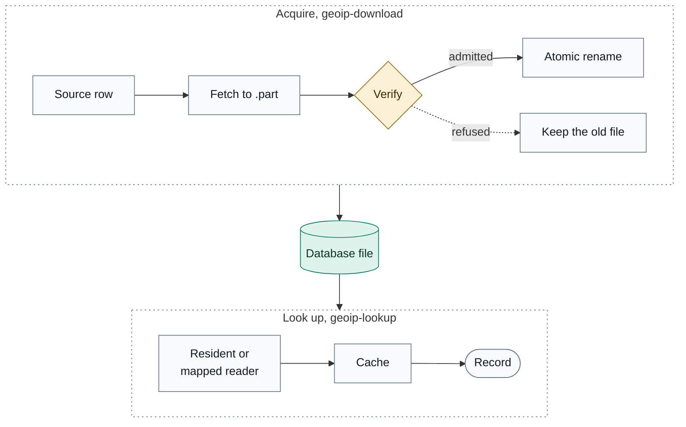
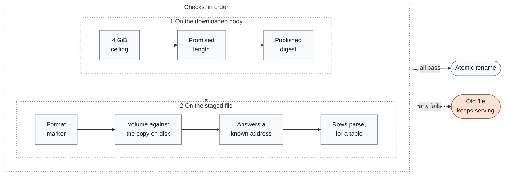
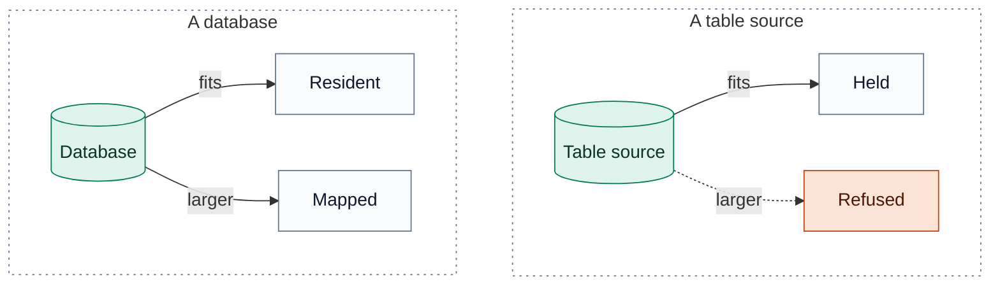

<!-- Project:   factbook -->
<!-- File:      docs/architecture.md -->
<!-- Purpose:   How acquisition, verification and lookup fit together -->
<!-- License:   Apache-2.0 -->
<!-- Copyright: (c) 2026 HYPERI PTY LIMITED -->

# Architecture

factbook is two halves that meet at a file on disk. Acquisition fetches and verifies, and lookup opens and caches. They are separate features, so a consumer can take either alone.

## The two halves meet at the database file

Acquisition renames a file into place once it passes every check, and lookup opens whatever file is there.

*Figure 1. L3 Components -- factbook. The dotted arrow is the refusal path.* Up: top of factbook-rs. Down: [L4 Detail -- Download checks](#a-refusal-keeps-the-previous-database), [L4 Detail -- Database and table backing](#a-database-that-will-not-fit-is-mapped-and-a-table-that-will-not-fit-is-refused).

Nothing passes a record between the halves. So a deployment that pre-seeds its databases, or mounts them read-only, can take the lookup half and no HTTP stack at all.

## The atomic rename is what makes the memory map safe

A reader over the resident ceiling holds a memory map of the file. Writing a refresh into that file in place changes bytes underneath a live mapping, which is undefined behaviour. Downloading to a `.part` file and renaming means the mapped inode is never written to, so the old reader keeps answering from it until something reopens it.

A resident reader has no mapping to invalidate. The rename still matters for it: a reader opened part way through an in-place write would read half of one build and half of another.

`refresh_if_changed` is that something. It stats each file, reopens whichever moved, and swaps the reader set in one atomic store. Nothing starts a timer. A library that spawns a thread imposes that thread on every consumer, so the schedule belongs to the caller.

Nothing dangles if a process dies mid-update:

- The transfer holds an advisory lock on a `.lock` file beside the destination, so two processes sharing a data directory cannot interleave into it. A filesystem with no lock support logs a warning and the transfer goes ahead. The lock gets a file to itself because the part file can be unlinked and recreated mid-transfer, and a lock follows the inode rather than the name.
- The kernel releases the lock when the process holding it goes away. Cancelling the download does not release it early: the step renaming the staged file holds it until that file is placed or removed.
- A second process finding the lock held is turned away before it makes a request, so it spends none of the provider's quota and reads what is on disk.
- A panic during the reader swap poisons a lock guarding a path and a timestamp. It is recovered rather than failing every refresh from then on.

## A refusal keeps the previous database

The transfer checks what arrives, and the guard checks the staged file before the rename. Nothing is checked at the destination, because a bad file there would have a fresh modification time the freshness check would then refuse to replace.

Up to seven checks run in order, and the file is renamed into place when every one passes. A check with nothing to test passes: no published digest, no declared length, or the floor or probe turned off.

*Figure 2. L4 Detail -- Download checks. The dotted arrow is the refusal path.* Up: [L3 Components -- factbook](architecture.md).

A short body is the one refusal that keeps its bytes, because they are a valid prefix of the file. The next run continues from them with a `Range` request when the result can be checked afterwards: a published digest, or a gzip body with a checksum that fails on a splice. A raw body with no digest starts again, because a server can answer a range from a rebuilt file.

The body ceiling stops a response that never ends from filling the data filesystem. A declared length past it is refused before a byte lands. The same ceiling bounds what a gzip body, or the member taken from a tar archive, writes as it is unpacked.

A refused or rate-limited download writes a `.retry` stamp beside the lock: the time before which the database or table is not asked for again. A 429 waits the seconds `Retry-After` gives and any other refusal waits an hour, both capped at a day. The stale copy serves meanwhile, and a download that passes removes the stamp.

Failures of the network itself start no wait. A rejected credential, a missing entitlement or another 4xx about the request is held back in memory, until the configuration behind the request changes or a day passes. So a restart with a corrected credential asks at once.

The digest, where a publisher has one, is the expensive check: a full read and hash of the archive. The last three belong to the guard, which runs the volume floor first because two `stat` calls cost less than opening a database. The last two never both apply: a provider database is probed for an address, and a table is loaded as the source states it (rows, width, key column and resident ceiling).

## The cache is keyed on the address, not its text

Most reference lookups are repeats, and the cache saves a database traversal on each.

- The key is `IpAddr`, so `::1` and its long form are one entry, and no string is hashed or allocated per lookup.
- A hit hands back an `Arc`, because copying a record to reproduce something in memory costs more than the hit itself.
- Private and reserved ranges never reach the cache. They cannot have an answer, so they short-circuit to one shared record.

Cached answers are cleared when `refresh_if_changed` swaps the reader set, rather than aged out on a timer, because an answer goes stale when the file behind it changes. A lookup already running when the swap lands can finish on the old readers.

## A database that will not fit is mapped, and a table that will not fit is refused

A database larger than `resident_max_bytes` is mapped and still served, and a table source is refused when its read crosses it.

*Figure 3. L4 Detail -- Database and table backing. Both database backings answer through the cache, and orange is the refusal.* Up: [L3 Components -- factbook](architecture.md).

A database is in the format the reader reads. One larger than `resident_max_bytes` is memory-mapped instead of being read onto the heap, and it answers through the same cache, so a repeat address never touches the file.

A table is a CSV or a JSON document, and turning one into rows and an index costs several times the file. It cannot be mapped, because it has to be parsed to be used.

The ceiling is hit, never predicted. Size on disk does not say whether a source fits, because encoding, quoting and column count all move the answer. So the read fills memory and stops when it crosses the line. A CSV stops partway through a field and a JSON array partway through an element, and what the read had taken is released as the refusal unwinds.

A refused table has no fallback. Writing an oversized source out as a MaxMind DB and serving it mapped is not built, tracked in [issue #2](https://github.com/hyperi-io/factbook-rs/issues/2). `Table::backing()` and the `enrichment_table_backing` gauge report where a table's rows are, and the one answer is `resident`.

## One record type, several source schemas

Providers disagree about how a record is written. MaxMind nests, and DB-IP and sapics follow it. IPinfo is flat and writes an autonomous system number as text with an `AS` prefix.

Each database names its schema in its metadata, so the reader dispatches on the file rather than on config, and a pre-seeded file reads like a downloaded one. Every schema lands on the same flat record, which is what lets answers from different sources merge.

The typed fields are the set the schemas share, and each provider fills a subset of them. After the typed decode the record is read a second time with no schema and flattened to dotted paths (`city.names.de`, `subdivisions.0.iso_code`, `isp`). Everything the typed decode did not take lands in `record.extra`, up to 512 fields and 64 KiB a record, so a paid edition, a richer free build or a provider nobody has written a field for delivers its fields with no change here. The test is on the value rather than the path alone, which keeps a superseded subdivision, or a field with a wire type the typed decode refused, in the map.

The cost is a second record decode on each cache miss. A deployment that would rather have the memory back sets `CacheConfig::collect_extra_fields` to false, which skips the second decode rather than discarding its result.

## Features draw the dependency line

| feature | pulls in | for |
|---|---|---|
| `geoip-download` | HTTP, TLS, gzip, tar | fetching and verifying, and tables |
| `geoip-lookup` | resident or mapped reader, cache | answering |
| `metrics` *(default)* | the `metrics` facade | download outcomes, database age and backing |
| `metrics-lookup` | the same facade + `geoip-lookup` | cache hits, misses, size and lookup duration |

A download-only build has no database reader, and a lookup-only build has no HTTP client, because neither feature lists the other's dependencies. CI checks that with a feature-matrix build, which catches a module behind one feature using a crate another feature declares. Test builds are the exception: the dev-dependencies pull an HTTP client whatever features are selected.

`metrics-lookup` names `geoip-lookup` because the cache it instruments is there. Taken without it, every call site it would emit from is compiled out, so the feature would pull a dependency and measure nothing.

No feature is declared for a capability the crate does not have. Writing a table out as a database is not built, so there is no `geoip-convert` to enable: a feature that pulls the MMDB writer and changes no behaviour is one a consumer cannot tell is doing nothing.

The two metrics features split on cost. Acquisition metrics run once per database per refresh, so they are on by default, and the database-age gauge shows stale data whatever stopped the downloads. Lookup metrics cost three to four times a cache hit, on the path the crate exists to make fast, so they are opt-in. Details: [metrics.md](metrics.md).

There is no VRL feature. A host embedding VRL will want a record mapped into its value type, but declaring the feature before the code exists pulls two grammar builds into every consumer's build and returns no API.
